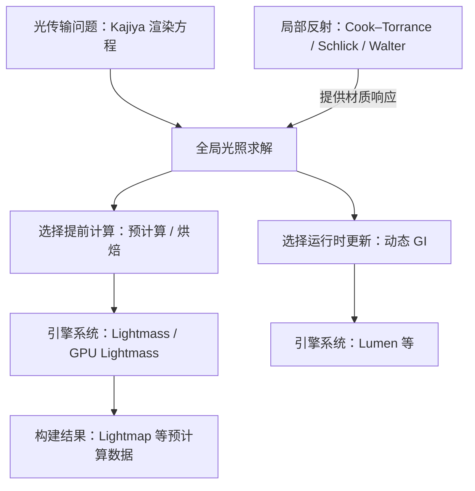
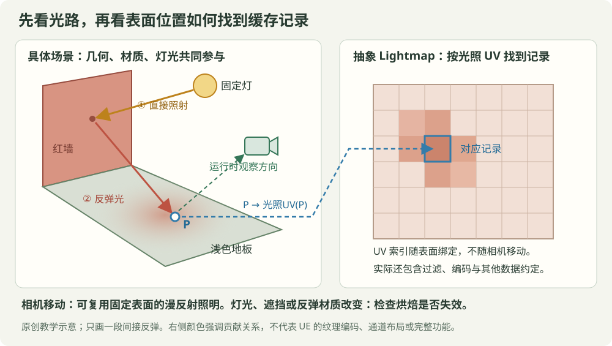

# Lightmass 在渲染知识体系中的位置

**Lightmass 是 Unreal 的预计算光照构建系统。理解它，可以沿“渲染方程 → 全局光照求解 → 预计算与烘焙 → 引擎系统 → 运行时使用的数据”这条线。** GPU Lightmass 属于 GPU 加速的烘焙实现；具体算法、功能与硬件要求还需要核对实现来源和引擎版本。

本文是知识关系专题，以已有论文笔记为理论入口。`[教学]` 标记表示为理解原理而采用的简化；外部资料的读取范围列在末尾，不据此推定当前官方插件的完整实现。

## 1. 先区分问题、方法、系统与数据

**读图**：上层说明要计算的问题，中层说明何时计算与更新，下层说明工程系统及其输出。箭头表示知识依赖和数据关系，没有声明 Lightmass 是某一篇论文的直接实现。动态 GI 也会使用缓存；它与烘焙的主要比较轴是更新时机、允许变化的条件和预算安排。

| 名称 | 所在层级 | 回答的问题 |
|---|---|---|
| 渲染方程 | 光传输的数学表述 | 场景中光怎样经由表面反射而相互影响？ |
| 路径追踪、Monte Carlo 积分等 | 数值求解方法 | 怎样近似计算光传输积分？ |
| 缓存、预计算、压缩 | 计算与数据组织策略 | 哪些结果能提前求出、存储并复用？ |
| Lightmass / GPU Lightmass | 引擎光照构建系统 | 怎样把输入场景处理成可供引擎使用的预计算光照数据？ |
| Lightmap | 结果的表示与存储形式之一 | 静态网格上的位置怎样索引到预计算光照信息？ |

**GPU 描述计算后端，不能单凭这个名称推断 CPU 与 GPU 实现采用相同求解器、缓存结构或输出编码。** 本文围绕预计算 GI 展开；产品中的静态直接光、阴影等如何参与构建，还取决于灯光移动性、渲染路径与版本。

## 2. 用“红墙照红地板”理解一次烘焙

**读图**：黄色箭头表示光源照到红墙，橙色箭头表示墙面向地板反射的间接光。地板上的同一个表面位置 P，通过光照 UV 找到贴图里的对应位置。蓝色虚线表示索引关系，绿色虚线表示运行时观察方向；它们不是额外的反弹光路。右图的红色只强调红墙贡献，没有表示 UE 的真实纹理编码或所有光照通道。

`[教学]` 对固定几何、灯光和材质，用一个 Lambert 漫反射接收点说明哪些量能提前计算：

$$E(x)=\int_{\Omega}L_i(x,\omega_i)\,(n\cdot\omega_i)\,d\omega_i,$$

$$L_{o,\mathrm{diffuse}}(x)=\frac{\rho(x)}{\pi}\,E(x).$$

这里 $E$ 是接收点的辐照度，$\rho$ 是线性空间的漫反射反照率。$L_i$ 包含其他表面的反射贡献，所以求它需要考虑整个场景；红墙的反照率会影响地板收到的光。

这个简化说明了：**视角改变时，固定表面的漫反射光照可以继续复用；改变灯光、遮挡或影响反弹的材质时，旧结果可能失效。** 具体 Lightmap 可以存方向信息或编码系数，不能把上述单个 $E$ 公式当成 UE 纹理通道定义。镜面外观仍涉及观察方向，不能直接套用这条视角无关的结论。

## 3. 接到库里已有的论文

| 知识入口 | 与 Lightmass 的关系 | 阅读时的边界 |
|---|---|---|
| [[Cook-Torrance — A Reflectance Model for Computer Graphics (1981)]]、[[Schlick — An Inexpensive BRDF Model for Physically-based Rendering (1994)]]、[[Walter — Microfacet Models for Refraction through Rough Surfaces (2007)]] | 提供理解局部材质响应的基础：光碰到表面后如何反射？ | BRDF 是光传输求解的输入；不能由此推断某版烘焙器使用完整 GGX 镜面路径。 |
| [[Kajiya — The Rendering Equation (1986)]] | 提供全局光传输的统一表述，以及数值求解的入口。 | Lightmass 要近似求解相关光照问题；它的工程身份不能等同于渲染方程或单个求解算法。 |
| [[Goral — Modeling the Interaction of Light Between Diffuse Surfaces (1984)]] | **Radiosity 源头**（2026-10-20 入库）：封闭腔 form factor + 能量矩阵解漫反射互反射；摘要一句"视角无关⇒可预计算"是烘焙路线的法理起点；红蓝盒"color bleeding"实验与本文第 2 节红墙实验同构。 | 论文的实现不含遮挡、仅凸四边形——它提供问题定义与合法性，不提供 Lightmass 的实现蓝图；具体求解器版本差异仍需单独核实。 |
| [[Ward — A Ray Tracing Solution for Diffuse Interreflection (1988)]] | 理解“昂贵的间接辐照度可以缓存与复用”的思想入口。 | Ward 的自适应辐照度样本与插值，和最终 UV 贴图属于不同的数据组织；没有证据就不能宣称某版 GPU Lightmass 使用该算法。 |
| [[Karis — Real Shading in Unreal Engine 4 (2013)]] | 通过 Split-sum 对照“哪些计算可以移到运行时之前”。 | BRDF LUT 以粗糙度、视角等索引材质响应积分；Lightmap 把具体场景的光照与表面位置关联。预滤波环境图是 Split-sum 的另一部分。 |
| [[Ramamoorthi-Hanrahan — An Efficient Representation for Irradiance Environment Maps (2001)]] | 提供理解漫反射光照如何压缩表示的入口。 | SH 是表示方法；Lightmap 是表面光照数据组织。不能仅因“都存光照”就认定产品使用同一种表示。 |
| [[Modern Real-Time Lighting Framework]] | 用计算对象、索引空间、复用条件和失效处理，对照 Lumen 等运行时系统。 | Lumen 有运行时缓存；将其称为“每帧完全重算所有反弹”会掩盖核心工程结构。 |

可以把两个熟悉的“提前计算”放在一起记：

- **Karis 的 BRDF LUT**：某个材质模型在不同粗糙度、视角下的反射积分响应。
- **场景 Lightmap**：某个具体场景在构建条件下，与表面位置对应的预计算光照信息。

## 4. 从实时预算框架看烘焙

沿用 [[Modern Real-Time Lighting Framework]] 的“采样 → 复用 → 重建 → 更新／失效”阅读法，关注阶段如何分配，而非假设它们具有相同 GPU pass：

| 问题 | 在烘焙工作流中怎么问 |
|---|---|
| 计算什么？ | 哪些直接光、间接光或遮挡项需要构建？接收的是哪类表面？ |
| 在哪里计算和存储？ | 构建时采样哪些场景位置？最终按 UV、空间位置或其他索引组织哪些数据？ |
| 怎样复用？ | 摄像机移动、重复渲染时，哪些预计算信息仍然有效？ |
| 怎样重建？ | 存储分辨率、编码、插值和过滤怎样影响细节、接缝与误差？具体实现需单独核实。 |
| 什么变化导致失效？ | 灯光、遮挡几何、发光和反弹材质改变后，哪些数据需要更新？ |

预算分成三个阶段：**构建阶段的采样时间与显存，资产阶段的光照 UV、分辨率与存储，运行阶段的流送、采样和剩余实时光照工作。** GPU 烘焙加速的是构建工作；烘焙能减少哪些运行时计算，由采用预计算结果的渲染方案决定。

动态物体如何接收预计算光照，需要另外核对探针、体积光照数据等机制及其支持范围，不能直接假设它们读取静态网格的 Lightmap。

## 5. 一个最小学习实验

`[教学]` 在已有支持光照烘焙的项目中，用一盏固定灯、一面红墙和一块浅色地板建立对照。先记录引擎版本、官方或社区实现、光照构建设置及运行时路径，再实验：

1. **只移动相机**：解释为什么静态漫反射照明仍可复用；将镜面变化单独观察。
2. **移动红墙或改变它的反照率**：比较更新烘焙前后的地板间接光，解释旧结果何时失效。
3. **只改变 Lightmap 分辨率**：比较光照细节、接缝、构建耗时与资源占用，不把分辨率增加等同于数值采样质量提高。

自测：Lightmass、Lightmap 和渲染方程分别是什么层级？Ward 的辐照度缓存与 Lightmap 有什么共同思想、又有什么不同？BRDF LUT 为什么通常不因移动一面墙而重算，而场景烘焙可能需要？

**这些是待执行的学习实验，不是本文已完成的引擎验证。** 本文不自动修改论文阅读状态或个人知识等级。

## 6. 来源与核验范围

- **理论定位**：来自上表所链接的库内论文笔记、[[Rendering Equation]] 与 [[Global Illumination]]。本文组织知识关系，不宣称重新核验了全部原论文。
- **官方入口**：[Epic — GPU Lightmass Global Illumination](https://dev.epicgames.com/documentation/en-us/unreal-engine/gpu-lightmass-global-illumination-in-unreal-engine)。本次会话访问被网络代理返回的 CONNECT 403 阻断，尚未直接读取；因此不在本文写定官方当前版的硬件、平台、灯光类型、降噪或多 GPU 支持表。
- **已读取的社区来源**：[dawnarc/GPULightmass](https://github.com/dawnarc/GPULightmass) README 明确标注为 Luoshuang 社区实现的镜像；[LightmassConfiguration](https://github.com/sgeraldes/LightmassConfiguration) README 说明较早 UE4 的 CPU/GPU 切换及烘焙质量工作流；[UE5 GPU Lightmass Watchdog](https://github.com/LarsH96/GPU-Lightmass-Watchdog-For-Unreal-Engine-5.x) README 说明烘焙自动化和问题资产排查。这些资料分别提供身份与工作流旁证，不是当前官方求解算法的证据。
- **实现身份**：Epic 内置插件与 Luoshuang 社区版、补丁版须分别记录版本和来源；不能混用安装方法与功能清单。
- **图示来源**：知识关系图及红墙／Lightmap 示意均为本专题原创教学图，未复制论文图或引擎界面。

相关：[[Rendering Equation]] · [[Global Illumination]] · [[Real-Time Global Illumination]] · [[Goral — Modeling the Interaction of Light Between Diffuse Surfaces (1984)|Goral 1984（Radiosity 源头）]] · [[Split-Sum Approximation]] · [[Modern Real-Time Lighting Framework]]
