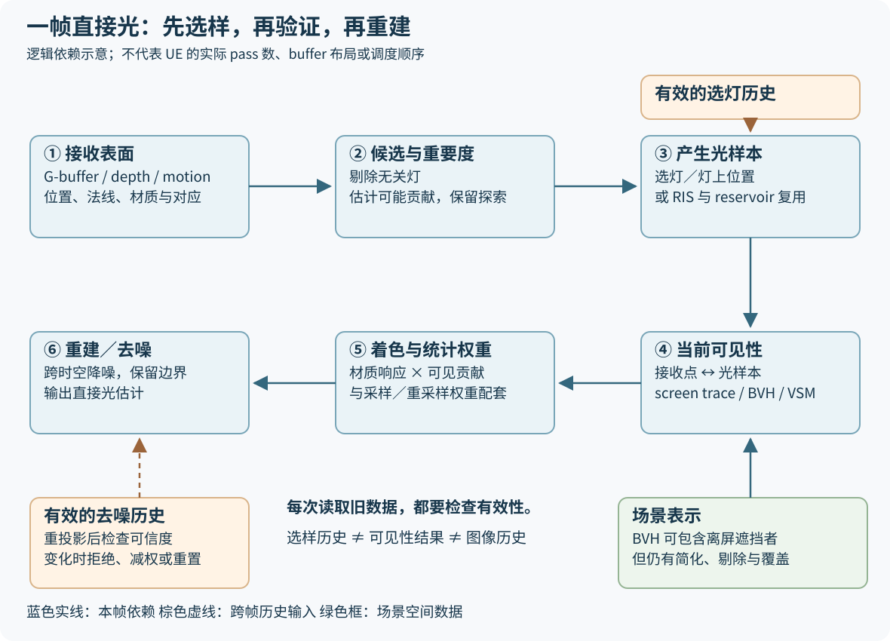
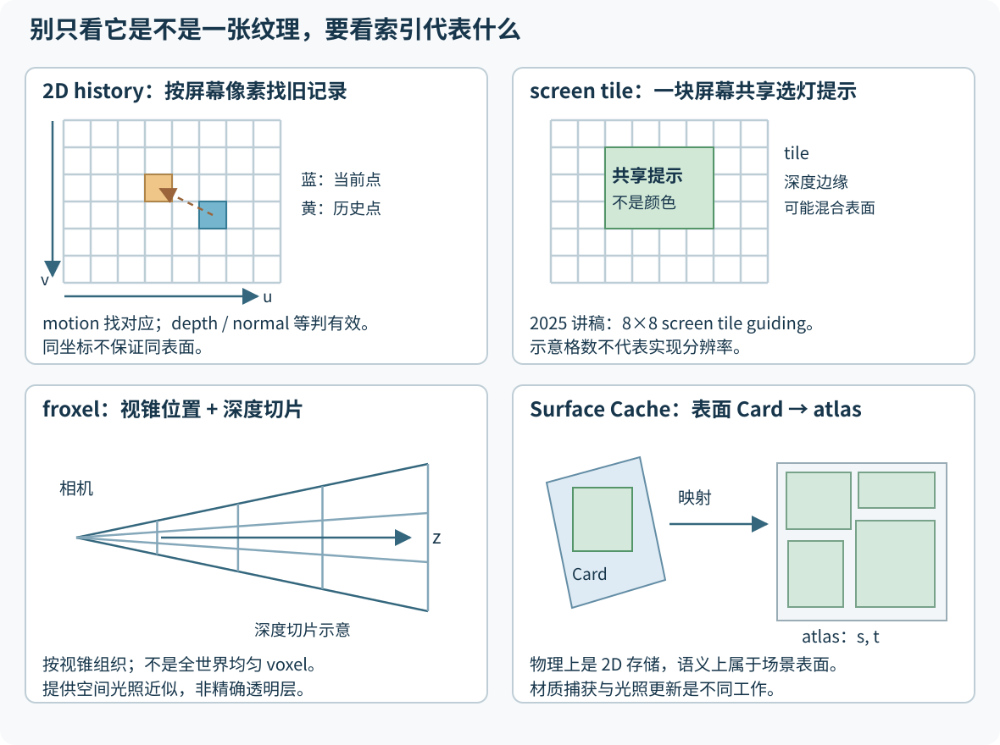
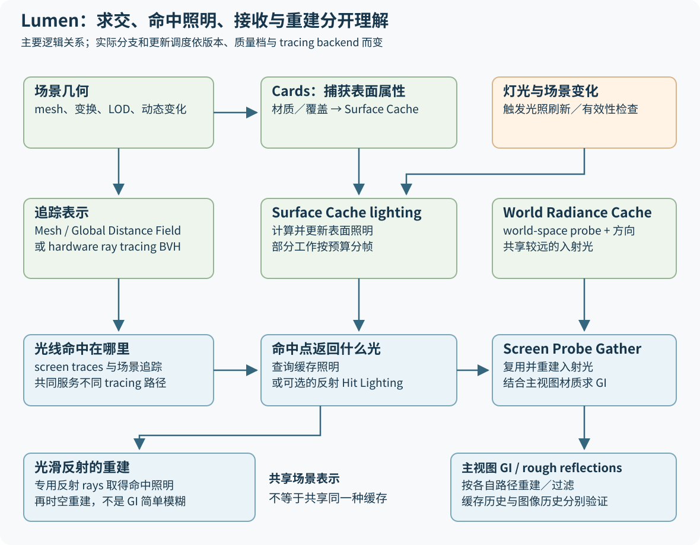

# 现代实时光照的共同设计框架

> **先决定把有限计算花在哪里，再复用仍然有效的信息，最后重建图像；场景变化时，必须知道该更新或丢弃哪一层。** 这是一套阅读技术的框架，不是声称 MegaLights、Lumen 和 ReSTIR 实现了同一种算法。

本文面向技术美术：从一帧画面中的光照问题出发，逐步进入采样概率、历史可信度、缓存索引和公开代码。重点不是记住某个开关，而是能解释：为什么画面变噪、为什么会拖影、为什么离屏物体仍应投影，以及该找哪一类成本和数据。

阅读顺序：先读第 1–4 节建立地图，再读第 5–8 节比较实现，最后用第 9–12 节排查和练习。文末的证据表给出版本、固定代码提交和取证限制。

**标记约定**：`[论文]` 指研究方法；`[产品]` 指指定版本的官方文档或作者讲稿；`[代码]` 指本文实际阅读的公开实现；`[教学]` 指为理解而抽象的流程、公式或排查建议；`[未确认]` 表示证据不足。没有标签的过渡解释沿用所在段落的标签，不应当成引擎源码说明。

## 1. 先分清它们分别在解决什么

想象一条雨夜街道：路灯照到墙上，是 **direct lighting**；墙把光反射到屋檐下，是 **indirect lighting / GI**；在水面或光滑车漆里看到街道，需要求反射方向上的光。物理上都属于 light transport，实时引擎为预算、材质和稳定性把它们拆成不同任务。

| 名称 | 主要角色 | 该怎样比较 |
|---|---|---|
| **MegaLights** | UE 中的 stochastic direct lighting 路径：选择少量光样本，做遮挡和着色，再重建 | 看直接光预算、选灯、可见性、去噪；不是 GI 系统的别名 |
| **Lumen** | UE 的动态 GI 与 reflections 系统：组合追踪表示、Surface Cache、gather 和多层复用 | 看间接光从哪里来、命中点如何着色、各层更新速度 |
| **ReSTIR** | 从直接光发展出的 reservoir resampling 方法族 | 看复用的样本是什么、如何换到当前接收点、权重是否仍成立 |
| **RTXDI** | NVIDIA 公开可读的 SDK 与示例，把重采样方法接入实际 renderer | 它是实现载体；本文锁定的 3.1.0 同时包含 ReSTIR DI、ReGIR、GI、PT |

依据：[MegaLights 5.6 文档][M56]、[Lumen 作者博客][LB]、[ReSTIR 原始项目页][R20]、[RTXDI Integration][CI]。**算法、引擎系统、SDK 不是同一层级，不能只列“谁更先进”。**

### 共同框架：采样 → 时空复用 → 重建／去噪 → 更新／失效

`[教学]` 用下面五个问题读任何方案：

1. **算什么？** 直接光、间接入射光、反射路径，还是体积散射？
2. **在哪算？** 屏幕像素、screen probe、世界空间 probe、表面 Card，还是 froxel？
3. **存什么？** 几何、材质、辐射亮度、候选样本及统计量、选灯提示，还是图像历史？
4. **什么时候能复用？** 相同表面、相容方向、有效灯 ID、接近的遮挡和材质，分别如何检验？
5. **失效以后怎么办？** 重算、回退到新样本、缩短历史、降低置信度，或等待预算分帧更新？

四阶段不是一条不可回头的 GPU pass 清单。上一帧的复用信息可以在当前帧**采样之前**指导分布；失效检查发生在每次读取历史时，缓存维护也可能独立调度。不要把“更新／失效”误解为只在帧末运行一次。

| 用同一框架看 | 采样 | 时空复用 | 重建／去噪 | 更新／失效 |
|---|---|---|---|---|
| **MegaLights** | 直接光样本 | 历史可见灯等 guiding；不要自动套用 reservoir | 从随机直接光估计重建 | 探索发现新可见灯；历史与场景表示分别维护 |
| **Lumen** | 间接光／反射方向与命中查询 | 表面照明、screen probes、world probes 等多层复用 | gather 中的重建与反射过滤等 | coverage、照明更新预算、屏幕历史各有失效条件 |
| **ReSTIR 方法族** | 候选 light / path samples | reservoir 统计与样本重采样 | 输出仍可能有噪声，可接重建器 | 重评价目标、处理来源域和历史有效性 |
| **RTXDI 3.1.0** | 应用桥接场景与采样模块 | 具体 DI / GI / PT 函数与可选 ReGIR | sample 展示重建输入与 confidence 集成 | 实际函数暴露匹配、索引、历史和 bias-correction 策略 |

这是后文各节的摘要；同一列中出现“复用”，并不证明复用的是相同数据。

## 2. 不透明表面：从 G-buffer 走到最终直接光



**读图**：实线表示本帧的数据依赖；虚线表示经过验证的跨帧反馈。选灯引导进入“选什么”，去噪历史进入“怎么重建”；它们不能互换。③ 中的 reservoir 复用属于另一种具体采样分支，另需读取自己的样本历史，图中未展开全部输入。图是共同逻辑抽象，不承诺某版 UE 的 dispatch 数量、资源布局或执行顺序。

### 2.1 G-buffer 给出接收光的位置和材质

`[教学]` 不透明物体通过光栅化确定当前相机可见的表面。深度配合相机矩阵可重建位置；法线、roughness、材质参数等告诉照明过程这个表面如何反光。motion vectors 用于跨帧对应，不是照明本身。不同引擎会压缩、拆分或重建这些属性，因此“逻辑需要什么”不等于“某张纹理的哪个通道”。

一个普通 opaque G-buffer 通常只描述每个像素最前面的不透明表面，**不会自然包含它后面的每层透明表面**。这决定了透明物体为什么需要其他路径。

### 2.2 先缩小候选，再按重要度选光样本

`[教学]` 几何范围剔除先排除不可能贡献的灯；importance sampling 再把预算倾向可能贡献较大的候选。材质、方向、距离、灯的形状和亮度、历史可见性都可能影响重要度估计，但不同方法采用的代理量不同。

“贡献很可能小”和“物理上一定为零”需要分开。粗略 guiding 不应永久封死可能重新出现的光源。MegaLights 官方文档明确说明：历史上被挡住的灯也需要周期性探索。[M56]

### 2.3 遮挡测试回答这一条连接现在是否可见

对被选中的接收点与光样本连接，visibility test 决定它是否被几何挡住。**选到了灯，不等于光能穿过墙。** area light 还需要选择发光面上的位置；多次采样同一盏灯的不同位置，也可以产生不同的软阴影结果。

`[产品：5.6]` MegaLights 先用短 screen-space trace 补细节，不能继续可靠判断时转到 Ray Tracing Scene；选择 VSM shadow method 的灯走另一种可见性来源。screen depth 只看到当前视图；**BVH 则可以包含离屏或被前景遮住的物体**。因此离屏遮挡并不要求遮挡者先出现在 G-buffer 中。不过 BVH 也有范围、剔除和几何简化，不能理解成“全世界所有精确三角形”。[M56]

### 2.4 概率权重负责补偿抽样，而不是给遗漏灯随便加环境光

`[教学：仅限离散点灯例子]` 假设某个固定表面上，第 $i$ 盏灯经过材质和当前遮挡计算后的真实贡献是 $c_i$，全部直接光为：

$$L=\sum_{i=1}^{K} c_i.$$

若独立、有放回地按离散概率 $p_i$ 抽取 $N$ 次，且所有非零贡献都满足 $p_i>0$，普通 Monte Carlo 估计可以写成：

$$\widehat L=\frac{1}{N}\sum_{j=1}^{N}\frac{c_{I_j}}{p_{I_j}},\qquad I_j\sim p.$$

这里 $K$ 是候选灯数，$N$ 是采样次数，$p_i$ 是归一化的**离散概率**。例如两个贡献分别为 9 和 1 的点灯，取样概率为 0.9 和 0.1，在这个刻意理想化的例子里，任一次的加权贡献都等于 10。它说明“经常选亮灯”和“仍然估计全部灯”能够同时成立。

**这不是 MegaLights 的 PDF 公式，也不能直接套在 ReSTIR 重采样输出上。** 面光源有位置／方向的连续密度及测度变换；ReSTIR 还要处理 reservoir 的统计权重和来源域。记住正确原则即可：采样分布、权重、可见性和目标积分必须匹配；不能只把抽到的贡献裸加起来，也不能把任意历史权重叫作精确 $1/p$。

### 2.5 重建把稀疏观测变成图像

`[教学]` 采样产生的是带噪估计。重建可以利用相邻像素和历史，但要避免把另一表面的亮度混进来。常见办法是把 diffuse / specular 信号分开，减少材质颜色对滤波的干扰，用深度、法线等阻止跨边界混合，再根据变化速度调整历史。

这条解释对应 [SVGF 研究][SVGF] 的时空重建思想，以及 [RTXDI sample 的 ShadingHelpers / ShadeSamples][CS] 和 [Confidence 文档][CC] 中可实际查到的信号准备与历史反馈。它**不表示 UE 使用 NVIDIA denoiser**，也不表示所有 GI、透明和体积都能共用一套过滤器。

## 3. “缓存”到底缓存了什么

先给每份持久数据写清楚“内容、索引、使用者、有效条件”。下面的分类是语义分类；同一个系统可能把多类信息放在相关资源里。

| 类别 | 保存什么 | 如何找到它 | 更新或弃用的条件 | 不要误认成 |
|---|---|---|---|---|
| **几何表示**：BVH、Mesh / Global Distance Field | 可供求交或距离查询的场景表示；BVH 是加速结构，不是光照结果 | 世界空间射线、实例／几何层级或距离场空间位置 | 变换、形变、LOD、增删对象、剔除或 streaming 改变时维护 | 灯光缓存、屏幕颜色 |
| **材质表示**：G-buffer / Surface Cache 的材质部分 | 当前可见表面属性，或 Card 捕获的表面属性 | 前者按屏幕像素；后者由命中表面映射到 Card / atlas | 表面变化、捕获变化、分辨率或覆盖不足时重建／重捕获 | 已经积分好的 GI |
| **光照缓存**：Surface Cache lighting、Radiance Cache | 已求得的表面光照或方向性入射 radiance 等结果 | 表面参数化，或 probe 位置与方向 | 光源／遮挡／材质变化，覆盖范围变化；受更新预算约束 | 一份仅含灯 ID 的列表 |
| **样本 reservoir**：ReSTIR DI | 被保留的光样本，以及支持重采样的统计量；工程中可额外存 visibility 复用信息 | 2020 DI 和本文 RTXDI 路径主要按屏幕像素索引，跨帧重投影 | 表面不匹配、灯 ID 消失、历史过长；复用时重新评价目标权重 | 最终像素的平均颜色，或完整灯光概率表 |
| **选灯概率引导**：MegaLights screen tile guiding | 历史可见灯等有助于分配采样预算的信息 | 2025 讲稿所述 screen tile 与重投影位置 | 新帧可见性反馈、探索结果、失去有效对应；精确规则依实现 | ReSTIR 的 per-pixel reservoir，或最终 visibility 判决 |
| **去噪历史** | 过去的光照估计，以及方差／历史长度／置信度等辅助量，具体字段依算法 | 2D 像素或重建域，依 motion 重投影 | disocclusion、相机切换、表面／光照变化时拒绝、限幅或减权 | 可供重新着色的灯样本 |

上述产品部分依据 [Lumen Technical Details][LT]、[Lumen 作者博客][LB]；reservoir 与历史维护的代码证据见第 7 节。BVH、Surface Cache、reservoir、denoiser history 的**有效期不会自动相同**。

### 一个关灯例子就能看出区别

`[教学]` 某盏灯关掉但几何完全没动：BVH 未必需要重建；灯数据和选灯引导需要响应；reservoir 若引用该灯，需要重新评价贡献或处理其删除；Surface Cache 的已缓存照明可能等待更新；图像去噪历史可能仍保存亮斑。画面“慢慢暗下去”可能来自后两层中的任意一层，也可能叠加，不能统一归为 TAA。

## 4. 2D、screen tile、froxel 和 Surface Cache 的空间地图



**读图**：图中的 $u,v$ 只表示屏幕方向；$z$ 表示视空间深度，不规定引擎的轴朝向、正负号或深度切片公式。Card 的 $s,t$ 是表面捕获参数，不能当作 screen UV。示意网格数量不代表实际分辨率。

| 表示 | 解决的问题 | 容易误解的地方 |
|---|---|---|
| **2D history** | 上一帧哪里对应现在这个像素；用 motion 找历史，再判有效性 | 相同屏幕坐标不一定是同一物体。历史纹理是 2D，不代表光线只能在屏幕空间传播 |
| **screen tile guiding** | 一小块屏幕共享选灯信息，降低维护和查询成本 | tile 跨越前后景时，信息只是粗略引导；它不替代当前样本的遮挡测试，也不等于移动 GPU 的 tile memory |
| **3D froxel** | 把视锥按屏幕方向和深度切开，在空间位置上计算／共享光照和阴影，再供雾或透明路径使用 | froxel 是 frustum voxel，通常随视图组织；不是自动覆盖世界的均匀 voxel，也不是精确透明表面列表 |
| **Surface Cache** | 让射线命中的表面能便宜地查询材质／缓存光照 | 纹理 atlas 虽然是 2D，语义是场景表面。它不是上一帧屏幕截图，也不是均匀的 3D radiance volume |

**再多区分两个“3D”**：Lumen world-space Radiance Cache 的 probe 保存光照；RTXDI 的 ReGIR world-space grid 给位置附近的光提供采样候选。二者都在三维空间组织，但存的量和下游操作不同。[LB][CI]

## 5. MegaLights：把直接光预算改成样本预算

### 5.1 重要的变化发生在 shading 和 shadowing 两端

`[产品]` 传统逐灯评估经常让重叠灯数同时推高光照计算与阴影成本。MegaLights 通过 stochastic sampling 限制昂贵评估的数量，再依赖引导和重建获得画面。因而不能仅理解为“给 Deferred Lighting 换一种 shadow map”。[M56]

`[产品：SIGGRAPH 2025]` 作者讲稿描述了**上一帧每个 8×8 screen tile 的 visible-light list**，通过重投影和 stochastic bilinear lookup 查询指导采样。它保存的是“哪些灯值得再试”的信息；不是照明颜色，也不是本文 RTXDI 的 reservoir。讲稿相关原文的在线索引已核到 tile 与深度不连续问题，完整细节还结合了本次独立只读研究补充；访问范围见第 13 节。[M25]

`[教学]` 遮挡灯应保留探索机会：门打开后，旧的“不可见”知识必须能被纠正。这里“探索”是让缺少证据或曾被遮挡的候选仍有机会被测试，**不是无视 importance 而平均浪费全部预算**。如何混合当前重要度和历史引导，是具体算法设计；本文不杜撰 UE 的精确混合公式、阈值或 buffer packing。

### 5.2 固定采样，不等于固定灯数，也不等于全帧恒定成本

`[教学]` 一帧的 $N$ 次光样本可能多次抽到同一盏 area light；这些样本也可能落到不同灯上。全场景可以存在远多于 $N$ 的灯。“每像素有限样本”绝不等于“这个像素永远只能接受 $N$ 盏灯”。

更实用的预算账本是：

```text
光照工作量 ≈ 场景表示维护 + 候选整理与重要度估计
           + 样本数 × 每条追踪／着色的代价
           + 时空复用与缓存读写 + 重建／去噪
           + 所选额外路径（例如 VSM、透明 front layer）
```

这只是成本分解，不是把 GPU profiler 中可能重叠的 async passes 直接相加。分辨率、BVH 复杂度、动态几何、带宽和额外路径都会影响最终 frame time。当前标为 5.8 的官方文档还明确列出重叠灯的重要度估计成本。[M58]

`[教学]` 对 TA 最有用的两条结论：

- **优化 bounds 既省钱也改善质量**：无意义的大范围灯让更多位置把预算花在最终没有贡献的候选上。
- **灯数不是唯一质量指标**：同样数量，强小光源密集重叠、细碎遮挡和高频高光，可能比空间分散的大灯更难采样。多样本能减小方差，但不能修复缺失的遮挡几何。

### 5.3 不要把示例设置误当默认配置

5.6 文档中的 `r.MegaLights.NumSamplesPerPixel 16` 位于提高质量的说明；5.7 也把它放在质量扩展示例中。**这不证明 16 是默认样本数。** 实际采样分辨率、quality tier 与 cvars 应以项目所用分支配置和运行时查询为准。本文没有核查授权 UE 源码，所以不给“默认每像素几条光线”的跨版本答案。[M56][M57]

## 6. Lumen：把间接光查询拆到几种不同表示里



**读图**：左侧决定射线“撞到哪里”，中间决定命中处“返回什么光”，右侧决定主视图“怎样接收和重建”。Surface Cache 不能画成 BVH 的替代品；world-space Radiance Cache 也不能画成 Surface Cache 的另一个名字。图中可选的 Hit Lighting 只指反射分支，不表示 Screen Probe Gather 同样启用它。图仅显示主要逻辑依赖，省略具体 tracing backend 与质量分支。

### 6.1 Surface Cache 有材质捕获，也有照明更新

`[产品]` Lumen 为 mesh 建立 Cards，把多视角捕获的表面数据放入 Surface Cache。命中点可据此查照明，避免每条射线都重新执行复杂材质和光照。**Card 的组织／覆盖、材质捕获、缓存照明更新是不同问题**；其中一项有效，不能保证其余都有效。[LT]

作者在 *Journey to Lumen* 中解释过早期把 Cards 用于几何追踪的探索，以及后来让它们承担表面计算缓存的变化。因此不能把早期实验中的 heightfield / cone tracing 管线当作当前 Lumen 的完整机制。[LJ]

### 6.2 Screen Probe Gather 与 world-space Radiance Cache 不在同一个域

`[产品／作者解释]` 对 diffuse GI，在屏幕上的稀疏采样位置收集方向性入射光，再结合全分辨率材质重建，可以让昂贵 traces 被多个像素共享。历史入射光还能指导本帧方向选择。较远的光照另借助 world-space Radiance Cache 复用；这对“小窗照亮室内”之类问题有帮助。rough reflections 可以利用相应 gather 信息；更光滑的反射通常需要额外追踪。[LB]

`[教学]` “采样点在屏幕上”只说明它从主视图的哪些位置出发；之后的射线仍可转到场景空间求交。世界空间 probe 的复用可以缓解对当前屏幕的依赖，但仍受覆盖、更新预算和方向分辨率限制。

### 6.3 反射不能简单等同 diffuse GI 再模糊一下

`[产品：5.6]` Lumen 可以从 Surface Cache 取得反射命中处照明，也提供 **Hit Lighting for Reflections** 这类更贵的选择。镜面方向对位置、法线和遮挡非常敏感，所以粗糙 GI 可以容忍的近似不一定能用于镜面。[LT]

`[教学]` MegaLights 与 Lumen 可以共存并共享 Ray Tracing Scene 的部分开销，但“使用同一 BVH”不等于“共享同一种光照缓存”或“一个开关涵盖另一个系统全部的 direct-light evaluation”。在未核查具体版本集成前，不声称 Lumen 的每次命中着色都自动调用完整 MegaLights 主视图路径。

### 6.4 更新延迟不全来自 denoiser

`[产品：5.6]` Lumen 性能文档分别讨论 Surface Cache 的 Direct Lighting、Radiosity 更新比例和 Radiance Cache probe 更新预算。工作可以分摊到多帧；快移相机或突然变光时，缓存未及时更新本身就会造成响应延迟。[LP]

`[教学]` 排查时分别看“缓存里的光是否已经变了”和“缓存变了以后，主视图历史是否还在保留旧光”。增加去噪强度可能掩盖噪声，却会让后一个问题更明显。

## 7. ReSTIR 与 RTXDI：复用的是样本及其统计意义

### 7.1 2020 论文的核心不是把旧颜色搬过来

`[论文]` ReSTIR 2020 从候选 light samples 中进行重采样，再复用时间和空间邻域的样本。reservoir 的意义是：用少量保留样本与统计量，代表处理过的候选集合。原研究包含 unbiased 与 biased 估计的讨论；不能把某种实时取舍包装成所有 ReSTIR 配置都无偏。[R20]

`[论文补充材料]` 邻居 reservoir 的样本分布可能不同；把它移到当前像素后，需要处理目标分布与归一化。补充材料 §1 与 Algorithm 1/2 特别讨论了 MIS：估计 MIS 权重使用的分布近似，和最终 estimator 是否无偏，是需要分别论证的事。**“两边都叫 PDF”不等于能直接互换。**[R20S]

### 7.2 用固定代码逐步看一遍

本文实际检出的版本：

- **RTXDI 3.1.0**：`a6efab966b7c3b272da0461578eb56ac61c7cbff`，提交日期 2026-09-03。
- 它的 **RTXDI-Library submodule**：`f12037fa8e97ebc08e9e3edfd2de528ed1772a4b`，提交日期 2026-09-03。

下面是代码阅读地图，不是抄写 NVIDIA 实现，也不把这些字段映射到 UE。

| 阅读入口 | 实际能核验什么 | 对框架的意义 |
|---|---|---|
| [`GenerateInitialSamples.hlsl` 的 `main` / `RayGen`][CInit] | 读取 `RAB_GetGBufferSurface`，调用 `RTXDI_SampleLightsForSurface`，写 reservoir | G-buffer 与初始采样明确连接 |
| [`Reservoir.hlsli` 的 `RTXDI_DIReservoir`、`RTXDI_StreamSample`][CR] | 保存样本引用、目标值、统计量；流式处理候选并按权重选择保留样本 | reservoir 存的是样本统计，不是已经平均好的图像 |
| [`TemporalResampling.hlsli` 的 `RTXDI_DITemporalResampling`][CT] | motion 回投；表面有效性与深度／法线检测；限制历史 `M`；映射灯索引；在当前 surface 重算 target；按选项做 bias correction | 每次复用都有有效性和权重问题 |
| [`SpatialResampling.hlsli` 的 `RTXDI_DISpatialResampling`][CSpatial] | 访问相容邻域并合并候选；归一化／bias correction 有不同路径 | 空间复用不是随意拿邻居颜色填空 |
| [`ShadingHelpers.hlsli` 的 `ShadeSurfaceWithLightSample`][CS] | 根据设置尝试复用 visibility，否则追踪；使用 reservoir 权重及光样本的密度信息着色 | 最终能量和选样统计必须配套 |
| [`Reservoir.hlsli` 的 `RTXDI_GetDIReservoirVisibility`][CR] | 检查 visibility 的 age 和 spatial distance | 可见性缓存也有自身有效期 |
| [`Confidence.md` 及其关联 shaders][CC] | 比较同一表面／光样本跨帧的照明变化，形成去噪置信度 | 样本复用与图像历史可以相互帮助，但仍是两层 |

**一个值得细看的细节**：灯索引映射失败时，temporal code 清掉旧样本的有效引用和权重，不是简单把整个结构所有字段归零；统计量处理属于归一化逻辑。本文刻意不把这简写成“失效就 memset reservoir”。[CT]

另一处细节是 `weightSum` 的含义随阶段变化：流式阶段是权重和，finalize 后用于 reservoir contribution weight。函数名或变量名里出现 PDF，不足以证明它是可直接写出的精确最终抽样密度。[CR]

### 7.3 重要度与历史可信度是两条轴

`[教学]` **重要度**问“现在该优先试谁”；**可信度**问“过去这条记录现在还能信多少”。某盏灯非常重要，但运动遮挡使其旧 visibility 不可信；某块墙历史非常稳定，却只收到很弱的光。不能把“重要度高”直接变成“历史权重高”。

`[代码]` 在本文的 temporal path 中，旧 light sample 会根据当前 surface 重新计算 target，而历史候选数会受到限制；可见性复用另按 age / distance 判定。更强的 bias correction 可能引入额外射线；如果需要上一帧可见性却只能用当前 BVH，代码注释明确指出偏差会增大。[CT][CR]

`[教学]` 这解释了为什么“只看到最后一次 shadow ray”不能用于推断整个 ReSTIR pass 的 ray budget。初始候选评价、复用校正和 final shading 是否追踪，依策略而变。**也不能反过来说 ReSTIR 的每个候选都必然追踪一条 shadow ray。**[CN]

### 7.4 GI、PT 后续解决了不同的复用对象

| 研究／实现 | 复用对象如何变化 | 不能推出什么 |
|---|---|---|
| **ReSTIR DI，2020** | 对当前接收面有贡献的 light sample | 不能仅改个名字就求出多跳 GI |
| **ReSTIR GI，2021** | 将间接路径产生的样本在时空复用；要处理不同接收点之间的路径连接关系 | 不能理解成“缓存一个 GI RGB，然后平均” |
| **GRIS / ReSTIR PT，2022** | 理论处理相关样本、不同域和 shift mappings，并展示多跳 diffuse / specular 路径复用 | 不是对任意路径简单复制 reservoir 就正确 |
| **RTXDI 3.1.0** | 提供 DI / ReGIR / GI / PT 的工程模块；应用提供场景、材料和可见性接口 | 不是一套无需改 renderer 的自动光照插件 |

来源：[ReSTIR GI 作者项目页][RGI]、[GRIS / ReSTIR PT 作者项目页][RPT]、[RTXDI 集成说明][CI]。其中 GI / PT 正文 PDF 的访问限制见第 13 节，本文不据摘要推导其完整数学证明。

`[代码／产品文档]` RTXDI 3.1.0 的 GI 集成文档进一步说明，它的基本 secondary-surface radiance 表示不带方向性；低 roughness 表面和尖锐焦散有局限，并讨论 final shading 中的 MIS 组合。因此“SDK 有 ReSTIR GI”也不意味着所有镜面、折射、焦散自动获得同等质量。[CGI]

## 8. 透明与体积：必须按版本、按路径讨论

### 8.1 先明确版本矩阵

| 资料范围 | 本次实际读到的说明 | 能得出的结论 |
|---|---|---|
| **MegaLights UE 5.6 文档** | translucency 不支持；另有 Volumetric Fog 支持 | 不能把后续透明功能倒写成 5.6 已有 |
| **MegaLights UE 5.7 文档** | lit translucency 与 fog 使用统一 froxel volume；forward shading 的 specular 以 SH 提取一个近似光表示 | 这是空间光照近似，不能当作所有透明层逐像素完整求光 |
| **MegaLights 无版本入口，本次页面标题为 UE 5.8** | frontmost forward-shaded translucent layer 有专用 G-buffer 和光照 pass；后层使用 volume | front layer 可有更细的表面光照，后层仍有不同质量边界 |
| **SIGGRAPH 2025 讲稿** | 描述作者当时的设计 | 讲稿机制不自动等于每个发行版、每个 quality tier 的默认行为 |

来源分别为 [5.6][M56]、[5.7][M57]、[当前页面][M58]、[2025 讲稿][M25]。版本化网页仍可能被网站维护更新；此表记录的是 **2026-10-13 的读取结果**，不是自行证明功能首发版本。无版本入口尤其会漂移。

### 8.2 Front layer 和 volume 近似的差异

`[产品：当前 5.8 页面]` front layer 额外描述最前透明表面的属性，再执行采样、追踪与去噪。更后面的层从 Translucency Lighting Volume 取得 diffuse，并用单个主方向近似 specular。front-layer G-buffer 可以和 Lumen Front Layer Reflections 共享部分开销，但后续 direct lighting 仍有自己的工作。[M58]

`[教学]` 玻璃上一条很窄的高光需要精确表面法线、视角和光源方向；粗 volume 很难保留这些细节。雾则是在空间中连续积分散射，本来就适合在体积格点计算后重建。因此两者都使用 froxel 或 volume，不代表误差表现相同。

“透明物体被照亮”“透明物体对其他物体投下透射阴影”“折射后还能正确看见多层照明”，是三个不同问题。支持前者不能直接证明后两者。普通 opaque motion / depth history 也不能不加处理地服务所有透明层。

**Forward-shaded translucency 与整个项目的 Forward Renderer 不是同一个开关。** MegaLights 文档仍列有与 Forward Renderer 的不兼容；不能因为透明材质存在 forward shading 路径，就宣布该主渲染器受支持。[M57][M58]

## 9. 噪声、拖影、漏光和响应延迟：先判是哪一层

以下是 `[教学：基于来源的排查推导]`，不是任何引擎都适用的自动诊断。每次只改一个变量，并同时观察原始照明、重建输出与 scene representation。

| 现象 | 优先考虑的原因 | 一个有区分力的实验 | 不宜直接下的结论 |
|---|---|---|---|
| 静止画面有随机亮点、颗粒 | 候选分布差、强小灯难命中、样本不足；也可能是间接路径难采样 | 固定相机和曝光，比较原始照明与累积结果；收紧无用 light bounds | “去噪越强越好” |
| 大片缓慢翻动的噪斑 | 重采样相关性、缺少新信息，或 denoiser 误判信号已稳定 | 观察原始采样序列；对比复用策略／历史长度 | “reservoir 的 M 大，就等于很多独立新样本” |
| 物体移动后留亮边／暗尾 | motion 错误、disocclusion 拒绝不够，或复用了过时 visibility | 同一动画分别观察原始照明和过滤结果；检查 history reset / confidence | “一律是 TAA” |
| 墙后稳定漏光，长时间不收敛 | RT 几何缺失／简化、剔除、SDF 厚度／coverage、最大 trace 距离；也可能是跨边界插值 | 对照主视图与 Ray Tracing Scene / Distance Field；暂时区分 screen traces 与场景追踪 | “加样本就能修好” |
| 镜中黑块、视角变动时突然出现 GI | Surface Cache 或 tracing coverage 不足，screen path 掩盖了缺失 | 看 Surface Cache 覆盖和 reflection view；与 Hit Lighting 方案做局部对照 | “全是采样噪声” |
| 开灯、关灯后缓慢变化 | 光照 cache 尚未更新、去噪历史滞后，或两者叠加 | 先看 cache 是否及时响应，再看屏幕过滤后的响应 | “只调 temporal blend 就够了” |
| 透明后层阴影／高光模糊 | 使用 volume 近似、空间分辨率不足、该版本没有 front-layer 路径 | 同一视角分别检查最前层与后层、确认版本和材质路径 | “opaque 的参数可以直接照搬” |

依据：[MegaLights 文档][M56]、[Lumen 排错说明][LT]、[Lumen 更新预算][LP]、[RTXDI Noise and Bias][CN]、[Confidence][CC]。**噪声是有限观测的不稳定；偏差是平均后仍可能错误。** 缺失几何导致的漏光、跨阴影边界错误复用和历史滞后，不会仅凭“看起来更平滑”而被纠正。

## 10. PC、移动平台和 UE4 学习边界

| 场景 | 应采用的判断 |
|---|---|
| **PC／本世代主机的 UE5 项目** | MegaLights 的直接光、Lumen GI／反射分别预算；检查 renderer、RT 能力、版本和 scalability，再在目标机测量。示例帧率不是项目保证 |
| **移动端 MegaLights** | Epic 文档仍列 mobile 不支持；Arm 在 2026-06-10 公开了基于 UE 5.7 修改的 Lumilings 实验，并明确不是 UE 官方 mobile support。这是实验移植证据，不能提升为通用可出货承诺 |
| **移动端 Lumen** | 5.6 专门的 mobile 页面写明：高端 Android、Vulkan SM5、desktop renderer 的实验路径，可有／无 HWRT；不代表默认 mobile forward／deferred 都可用。该页同时说明 iOS/tvOS/iPadOS 不支持 |
| **仍在 UE4 学习或维护项目** | G-buffer、BRDF、灯光剔除、shadow map／BVH、概率采样、motion、denoising 都可作为学习基础；MegaLights / Lumen 的 UE5 产品流程和 cvars 不能直接套到 UE4 |
| **独立 renderer 学习 RTXDI** | 可读 shader 与 SDK 接口能验证思想；完整集成仍需要应用提供 G-buffer、material、light representation、visibility 等，不是换一个材质节点 |

来源：[Epic 平台范围][M58]、[Arm 移动端实验][ARM]、[Lumen on Mobile 5.6][LM]、[RTXDI Integration][CI]。Lumen 总体技术页与 mobile 专页的 renderer 表述不完全一致；这里采用更具体的 **mobile 专页**限定条件。

`[教学]` 移动端尤其要把 render-target / history 的带宽、缓存读写、功耗和热稳定性计入判断，不能仅比较 ray count。Arm 博客的实验结果证明某个方案在其测试条件下可运行；其中面向入门的 ReSTIR 描述不能替代原论文和 RTXDI 代码，也不能据此说 ReSTIR 必然逐候选做昂贵 visibility。

## 11. 技术演进：继承思想，不画虚假的产品血缘

| 时间 | 本报告关心的变化 | 关系类型 |
|---|---|---|
| 2005：Talbot 等，RIS | 先从易抽取的分布产生候选，再向目标分布重采样 | ReSTIR 的理论前置；本文通过原论文补充与 SDK 文档核对这一关系 |
| 2017：SVGF | 通过时空信息和方差指导，从低样本照明重建图像 | 重建分支，不是 ReSTIR 本身 |
| 2020：ReSTIR DI | 把 reservoir sampling 与时空样本重用用于复杂直接光 | 采样复用分支 |
| 2021：ReSTIR GI；2022：GRIS / ReSTIR PT | 进一步讨论间接路径、相关样本与跨域映射 | 研究扩展，不能只比较样本计数 |
| 2022：Lumen 作者分享 | 用多种场景表示与光照缓存组织动态 GI／反射 | 产品系统；与重采样研究可比较，但不等同 |
| 2025：MegaLights 作者分享 | 对大量动态直接光组织有限采样、历史 guiding 与重建 | 产品路径；不能画成“ReSTIR 换名字进 UE” |
| 2026：本文核对的 RTXDI 3.1.0 | DI / ReGIR / GI / PT 模块和重建接口共存 | SDK 工程化的一份具体快照 |

### 可直接套用的比较模板

`[教学]` 以后看到任何“新光照方案”，先填这一行，再看宣传视频：

```text
目标积分：______  接收／求解域：______  新采样来源：______
复用的数据：______  对应关系／索引：______  权重校正：______
几何与可见性来源：______  重建方式：______
更新预算：______  失效与回退：______  平台／版本：______
证据：论文______ / 产品文档______ / 固定代码______ / 实测______
```

## 12. 给技术美术的最小实践路线

这些是 `[教学建议]`，本次没有运行 UE benchmark，也不改变知识库中的已读／掌握状态。

1. **两盏灯的采样实验**：固定接收面与遮挡，先求全灯参考，再按已知概率抽样。核对长期平均与参考一致；故意去掉概率补偿，观察错误。使用第 2.4 节的离散条件即可，不必先实现 ReSTIR。
2. **门开关的历史实验**：固定相机，让强灯位于门后。记录 raw lighting、guiding／reservoir（若工具暴露）、filtered output。分别观察“探索发现灯”“旧 visibility 失效”“去噪历史清理”发生在哪一层。
3. **离屏遮挡实验**：让遮挡物退出画面但仍位于接收点到灯的连线上。观察 screen-only 与包含该物体的场景追踪区别，并检查 culling；不要用删除物体替代离屏移动。
4. **Lumen 缓存实验**：快速转向此前未关注区域，再开关一盏强灯。对照 Lumen Scene / Surface Cache 与最终 GI，区分 coverage、更新预算和屏幕历史。
5. **透明分层实验**：确认 UE 版本后放置前后两层透明表面和窄高光光源。观察 front-layer 与后层的差别；不要仅看“是否开启 MegaLights”。

记录表至少包含：引擎精确版本、目标 GPU／renderer、内部与输出分辨率、quality tier、测试路径、静态与动态场景、GPU timings、原始信号和重建信号截图。实验目标是解释误差来源，不是凑一个脱离条件的性能数字。

### 与现有知识库连接

- 前置：[[Rendering Equation]]（要估计什么）、[[BRDF]]（表面响应）、[[Shadow Mapping]]（可见性的一种表示）。GitHub 入口：[Rendering Equation](../Concepts/Rendering%20Equation.md) · [BRDF](../Concepts/BRDF.md) · [Shadow Mapping](../Concepts/Shadow%20Mapping.md)。
- 上位主题：[[Real-Time Global Illumination]]。本报告补充它的机制框架，不继承其中未经本次独立核验的产业消息或性能数字。[技术主题页](../Technologies/Real-Time%20Global%20Illumination.md)。
- 工程联系：[[Temporal Stability and Artistic Intent]]、[[Real-Time VFX Performance Budgeting]]、[[Participating Media]]。对应 [时间稳定性](../Concepts/Temporal%20Stability%20and%20Artistic%20Intent.md)、[预算](../Concepts/Real-Time%20VFX%20Performance%20Budgeting.md)、[参与介质](../Concepts/Participating%20Media.md)。

## 13. 关键结论证据表与取证范围

**统一核验日期：2026-10-13。** “已读代码”表示检查了指定文件／函数，没有编译或运行该 SDK。没有访问、搜索或引用 NGR 私有源码，也没有读取 Epic 授权 UE 源码。本文的 SVG 均为自行绘制的逻辑示意，不是引擎截图或原讲稿图片。

| 结论 | 一手依据与定位 | 日期／版本 | 证据性质与限制 |
|---|---|---|---|
| 四阶段是比较框架，复用对象不能混为一类 | 本文对下面各来源的综合 | 本报告 2026-10-13 | **教学综合**，不是任何一篇论文宣称的统一架构 |
| MegaLights 固定采样预算，screen trace 可转场景追踪 | [Technique Overview / Performance][M56] | UE 5.6 页面 | 已读官方正文；不等于全帧恒定成本 |
| 2025 讲稿的 screen tile guiding 不应称作 ReSTIR reservoir | [MegaLights 2025 slides][M25]，检索 `8x8`、`guiding` | SIGGRAPH 2025 | 在线索引核到 tile / depth discontinuity；重投影与 stochastic lookup 的细节来自本次只读研究补充。完整 PDF 与准确页码在本执行环境未核实 |
| 透明路径发生版本变化 | [Limitations 5.6][M56]、[Lit Translucency / Forward Shading 5.7][M57]、[Forward Shaded Translucency 当前页][M58] | 5.6 / 5.7 / 标为 5.8 | 已逐版读取；不是功能首发版本考证 |
| Surface Cache、screen gather、world-space radiance caching 各有用途 | [作者博客的 Surface caching / Final gather and denoising][LB] | 2022-05-27 | 已读作者正文；不推断当前全部 GPU passes |
| Cards 早期追踪实验不能当作当前实现 | [Journey to Lumen，Shipping First Demo / Epilogue][LJ] | 2022-08-18 | 已读作者复盘；明确区分废弃探索与后来的用途 |
| Lumen 2022 技术分享入口 | [SIGGRAPH 2022 course][L22]，`Lumen: Real-time Global Illumination in Unreal Engine 5` | 讲稿更新 2022-09-19 | 已核作者／课程与资料链接；完整 PDF 受大小限制，本文详细机制以已读官方博客／文档交叉支撑 |
| Surface Cache / probes 有各自更新预算 | [Surface Cache / Radiance Cache 等性能说明][LP] | UE 5.6 | 已读官方正文；不能把所有延迟归因于去噪 |
| ReSTIR 2020 是样本重采样，有不同 estimator 取舍 | [原始作者项目页][R20]、[原论文 PDF][R20PDF]、[supplement §1、Algorithm 1/2][R20S] | TOG / SIGGRAPH，2020-07 | 已读项目页与两页原始补充正文；主文 PDF 过大，不能宣称完整通读其证明 |
| GI / PT 不是直接光 reservoir 的机械套用 | [ReSTIR GI][RGI]、[GRIS / ReSTIR PT][RPT] | 2021-06-24 / 2022-07-24 | 已读作者摘要／元数据；完整 PDF 未载入，不给未读证明细节 |
| reservoir、灯消失、历史长度、visibility age / distance 的具体行为 | [Reservoir][CR]、[TemporalResampling][CT]、[SpatialResampling][CSpatial] | Library `f12037f…`，2026-09-03 | 已检出并读指定函数；仅证明该提交行为 |
| 初始采样、最终着色和重建信号是不同阶段 | [GenerateInitialSamples][CInit]、[ShadingHelpers][CS]、[ShadeSamples][CShade] | RTXDI `a6efab9…`，3.1.0 | 已读代码；未搬用 buffer 二进制布局 |
| 重要度、偏差、去噪可信度不能混为一谈 | [NoiseAndBias][CN]、[Confidence][CC] | 同一 RTXDI commit | 已读 SDK 文档，与实际函数交叉核验 |
| SVGF 是重建研究而非选灯算法 | [SVGF 作者研究页][SVGF] | HPG 2017，2017-07-28 | 已读研究摘要；原始大 PDF 未载入，因此不把完整过滤器细节当作本次已核实现 |
| Lumen mobile 有具体实验条件 | [Lumen on Mobile][LM] | UE 5.6；页面说明 5.4 起实验支持 | 已读专页，优先于笼统平台表述 |
| MegaLights mobile 实验不等于 Epic 标准支持 | [Arm 的 Lumilings 文章，How to enable Megalights for mobile][ARM] 与 [Epic Platform Support][M58] | Arm 2026-06-10，基于 5.7 | 已读两个一手来源；不将 Arm 简化的算法比较当作 ReSTIR 定义 |

**尚未确认的范围**：UE 内部 buffer 布局、默认样本／tile 配置在每版每档的实际取值、精确 guiding PDF、完整失效阈值、MegaLights 与 Lumen 所有分支的集成状态，以及本项目目标机性能。原始大 PDF 的读取在网页工具受文件大小限制，执行环境直连下载返回 403；所以不伪造讲稿页码、完整论文阅读记录或 UE 源码验证。上表保留原始入口，便于后续在可读取环境补充。

### 来源链接

产品与作者材料：

- [M56：Epic MegaLights，UE 5.6][M56]；[M57：UE 5.7][M57]；[M58：无版本入口，本次标题为 UE 5.8][M58]。
- [M25：Krzysztof Narkowicz、Tiago Costa — MegaLights: Stochastic Direct Lighting in Unreal Engine 5，SIGGRAPH 2025][M25]。
- [LB：Daniel Wright、Krzysztof Narkowicz — Unreal Engine 5 goes all-in on dynamic global illumination with Lumen，2022-05-27][LB]。
- [L22：Daniel Wright、Krzysztof Narkowicz、Patrick Kelly — Lumen: Real-time Global Illumination in Unreal Engine 5，SIGGRAPH 2022][L22]；[原讲稿 PDF][L22PDF]。
- [LJ：Krzysztof Narkowicz — Journey to Lumen，2022-08-18][LJ]。
- [LT：Epic Lumen Technical Details，5.6][LT]；[LP：Lumen Performance Guide，5.6][LP]；[LM：Lumen on Mobile，5.6][LM]。
- [ARM：Arm — Lighting at scale: Bringing hundreds of dynamic lights to mobile with Unreal MegaLights，2026-06-10][ARM]。

论文与可读代码：

- [R20：Bitterli 等 — Spatiotemporal reservoir resampling for real-time ray tracing with dynamic direct lighting，2020][R20]；[主文][R20PDF]；[原始补充材料][R20S]。
- [RGI：Ouyang 等 — ReSTIR GI: Path Resampling for Real-Time Path Tracing，2021][RGI]。
- [RPT：Lin 等 — Generalized Resampled Importance Sampling: Foundations of ReSTIR，2022][RPT]。
- [SVGF：Schied 等 — Spatiotemporal Variance-Guided Filtering: Real-Time Reconstruction for Path-Traced Global Illumination，2017][SVGF]。
- [RTXDI 固定提交][RTXDI] 与 [RTXDI-Library 固定提交][LIB]。仓库代码可公开读取；其文件带 NVIDIA 许可标识，**公开可读不等于全部采用宽松开源许可**。本文只作原创解释和定位链接，不转载实现。

[M56]: https://dev.epicgames.com/documentation/en-us/unreal-engine/megalights-in-unreal-engine?application_version=5.6
[M57]: https://dev.epicgames.com/documentation/en-us/unreal-engine/megalights-in-unreal-engine?application_version=5.7
[M58]: https://dev.epicgames.com/documentation/en-us/unreal-engine/megalights-in-unreal-engine
[M25]: https://advances.realtimerendering.com/s2025/content/MegaLights_Stochastic_Direct_Lighting_2025.pdf
[LB]: https://www.unrealengine.com/tech-blog/unreal-engine-5-goes-all-in-on-dynamic-global-illumination-with-lumen?lang=en-US
[L22]: https://advances.realtimerendering.com/s2022/index.html#Lumen
[L22PDF]: https://advances.realtimerendering.com/s2022/SIGGRAPH2022-Advances-Lumen-Wright%20et%20al.pdf
[LJ]: https://knarkowicz.wordpress.com/2022/08/18/journey-to-lumen/
[LT]: https://dev.epicgames.com/documentation/en-us/unreal-engine/lumen-technical-details-in-unreal-engine?application_version=5.6
[LP]: https://dev.epicgames.com/documentation/en-us/unreal-engine/lumen-performance-guide-for-unreal-engine?application_version=5.6
[LM]: https://dev.epicgames.com/documentation/en-us/unreal-engine/using-lumen-global-illumination-on-mobile-in-unreal-engine?application_version=5.6
[ARM]: https://developer.arm.com/community/arm-community-blogs/b/mobile-graphics-and-gaming-blog/posts/lighting-at-scale-bringing-hundreds-of-dynamic-lights-to-mobile-with-unreal-megalights
[R20]: https://research.nvidia.com/labs/rtr/publication/bitterli2020spatiotemporal/
[R20PDF]: https://research.nvidia.com/sites/default/files/pubs/2020-07_Spatiotemporal-reservoir-resampling/ReSTIR.pdf
[R20S]: https://cs.dartmouth.edu/~wjarosz/publications/bitterli20spatiotemporal-supplemental.pdf
[RGI]: https://research.nvidia.com/publication/2021-06_restir-gi-path-resampling-real-time-path-tracing
[RPT]: https://research.nvidia.com/publication/2022-07_generalized-resampled-importance-sampling-foundations-restir
[SVGF]: https://research.nvidia.com/publication/2017-07_spatiotemporal-variance-guided-filtering-real-time-reconstruction-path-traced
[RTXDI]: https://github.com/NVIDIA-RTX/RTXDI/tree/a6efab966b7c3b272da0461578eb56ac61c7cbff
[LIB]: https://github.com/NVIDIA-RTX/RTXDI-Library/tree/f12037fa8e97ebc08e9e3edfd2de528ed1772a4b
[CI]: https://github.com/NVIDIA-RTX/RTXDI/blob/a6efab966b7c3b272da0461578eb56ac61c7cbff/Doc/Integration.md
[CN]: https://github.com/NVIDIA-RTX/RTXDI/blob/a6efab966b7c3b272da0461578eb56ac61c7cbff/Doc/NoiseAndBias.md
[CC]: https://github.com/NVIDIA-RTX/RTXDI/blob/a6efab966b7c3b272da0461578eb56ac61c7cbff/Doc/Confidence.md
[CGI]: https://github.com/NVIDIA-RTX/RTXDI/blob/a6efab966b7c3b272da0461578eb56ac61c7cbff/Doc/RestirGI.md
[CInit]: https://github.com/NVIDIA-RTX/RTXDI/blob/a6efab966b7c3b272da0461578eb56ac61c7cbff/Samples/FullSample/Shaders/LightingPasses/DI/GenerateInitialSamples.hlsl
[CR]: https://github.com/NVIDIA-RTX/RTXDI-Library/blob/f12037fa8e97ebc08e9e3edfd2de528ed1772a4b/Include/Rtxdi/DI/Reservoir.hlsli
[CT]: https://github.com/NVIDIA-RTX/RTXDI-Library/blob/f12037fa8e97ebc08e9e3edfd2de528ed1772a4b/Include/Rtxdi/DI/TemporalResampling.hlsli
[CSpatial]: https://github.com/NVIDIA-RTX/RTXDI-Library/blob/f12037fa8e97ebc08e9e3edfd2de528ed1772a4b/Include/Rtxdi/DI/SpatialResampling.hlsli
[CS]: https://github.com/NVIDIA-RTX/RTXDI/blob/a6efab966b7c3b272da0461578eb56ac61c7cbff/Samples/FullSample/Shaders/LightingPasses/ShadingHelpers.hlsli
[CShade]: https://github.com/NVIDIA-RTX/RTXDI/blob/a6efab966b7c3b272da0461578eb56ac61c7cbff/Samples/FullSample/Shaders/LightingPasses/DI/ShadeSamples.hlsl
